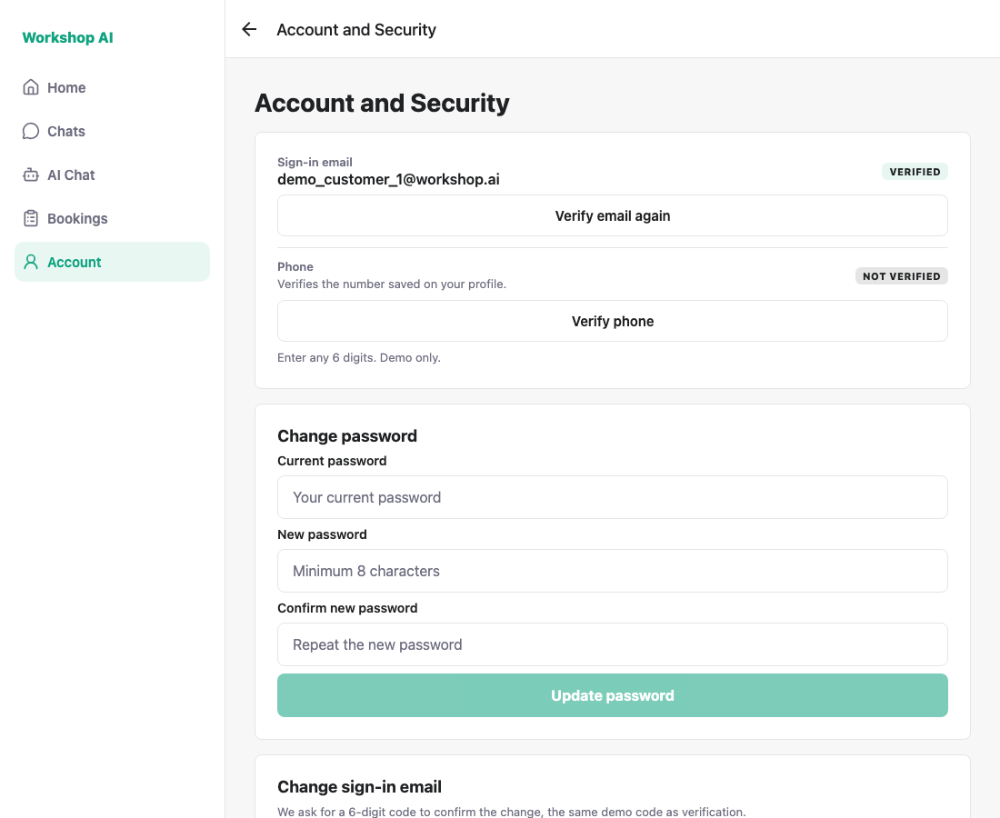
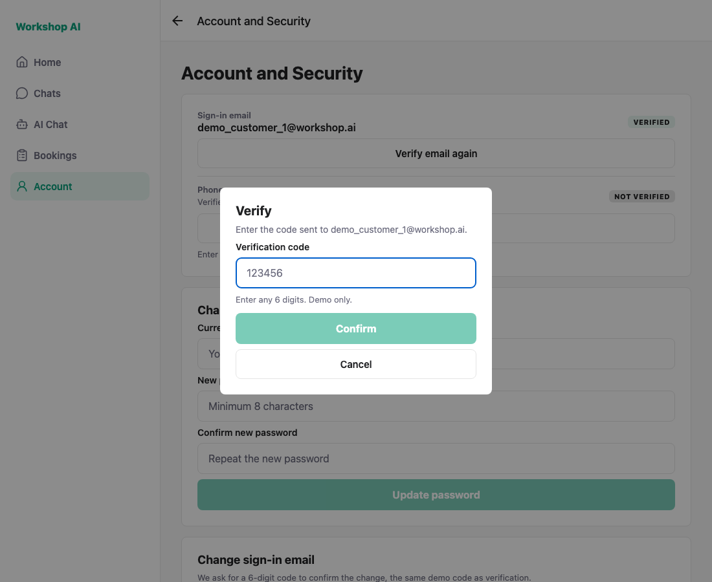
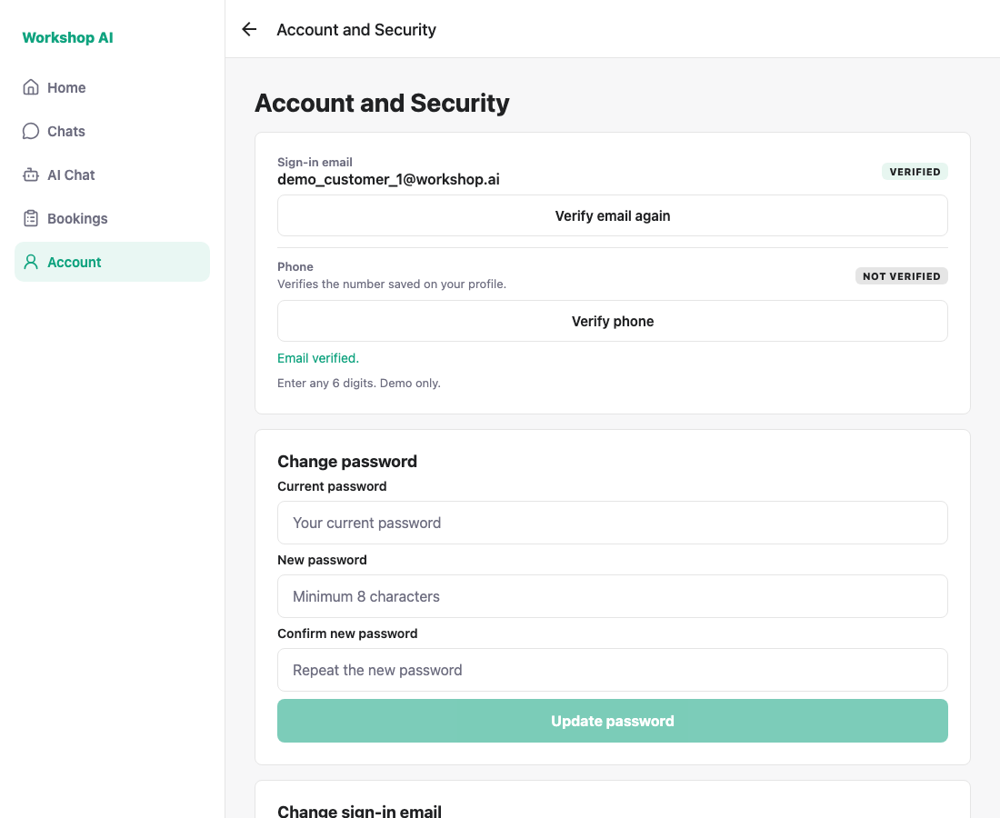
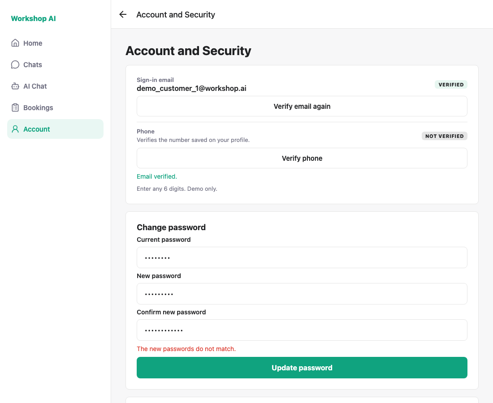
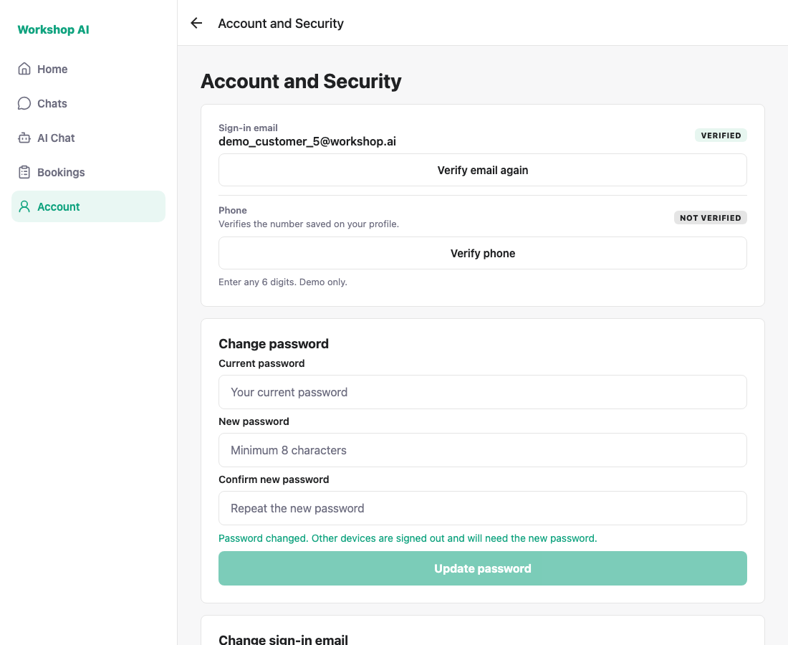
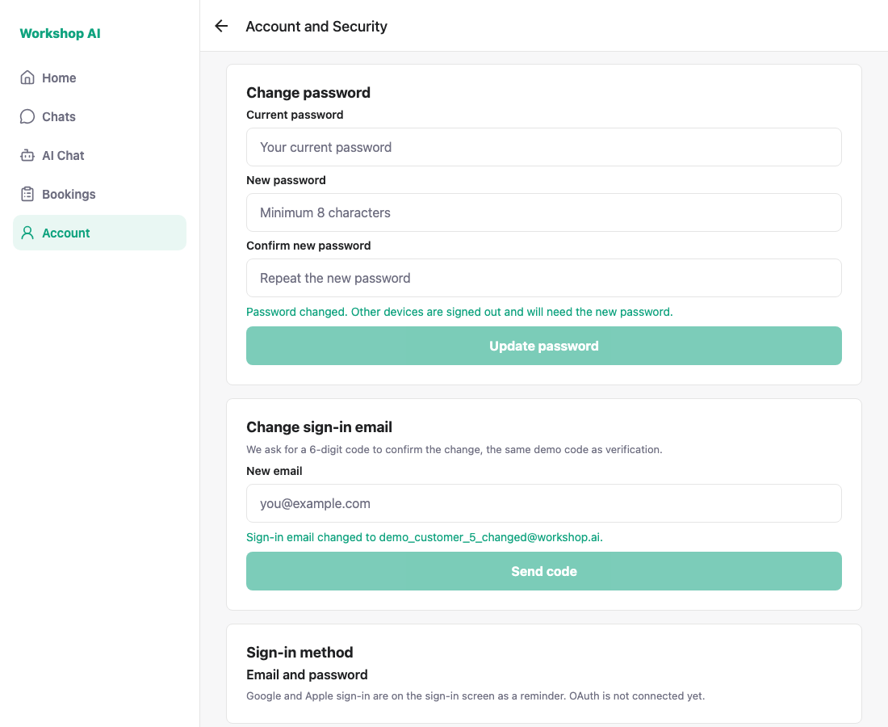

# Account security — historical captures

These screenshots and `shoot.js` preserve an earlier local demo. They are
historical UI evidence, not verification of the current foundation build.
No new browser capture was made during this review.

The captured demo accepted a placeholder six-digit code. That behavior is
obsolete: the current API sends an email code and checks its hash, recipient,
purpose, expiry, and usage. Arbitrary six-digit values do not verify email.

Captured against a locally running API on a seeded database, signed in as
`demo_customer_1@workshop.ai`, `demo_customer_5@workshop.ai` and
`demo_provider_16@workshop.ai`. Every image is a real run, not a mockup.

Destructive checks (a real password change and a real email change) ran on
`demo_customer_5` so the accounts used for demos keep their seeded credentials.
`shoot.js` attempted to restore that account at the end and asserted the result.

## 1. Account and Security — customer

One screen for both roles: verification status, change password, change email.
The email already shows **VERIFIED** here because an earlier run verified it;
the phone shows the unverified state.



## 2. Verify modal

The historical modal showed a demo hint. That hint is not current verification guidance.



## 3. Historical verification result with an obsolete placeholder code



## 4. Wrong current password is rejected

The error text comes from the backend, not from a local guess.


## 5. Mismatched new passwords are blocked

Checked in the screen before any request is sent.



## 6. Password change succeeds and the session survives

This earlier capture showed the screen signing in again after a password change.
It does not verify session behavior in the current build.



## 7. Historical email-change result



## 8. Same screen for a provider


---

## Current prerequisites

Use a disposable seeded database upgraded to the latest migration, the current
API, an Expo Web client on port 8090, and Playwright with Chromium. Current
verification and email-change checks require a configured email backend and
access to the recipient's inbox. Backend tests use the in-memory mail outbox
and the actual generated code. The provider needs a complete profile.

The helper retains historical selectors and placeholder-code assertions. Update
them and supply the delivered email code before using it for new captures.
It changes the spare account's password/email and attempts to restore them.

## Historical capture log

The earlier Playwright run printed the following log. Assertions about the demo
hint and accepting any six digits describe obsolete behavior:

```
PASS: customer reaches Account and Security
PASS: verify modal shows the demo hint
PASS: any 6 digits verifies the email
PASS: wrong current password is rejected
PASS: mismatched new passwords are blocked
PASS: password change succeeds and the session survives
PASS: change email confirmed with the demo code
PASS: spare account restored to its seeded email and password
PASS: provider reaches the same security screen
ALL CHECKS PASSED
```

The archived helper remains at:

```bash
docs/testing/account-security/shoot.js
```
