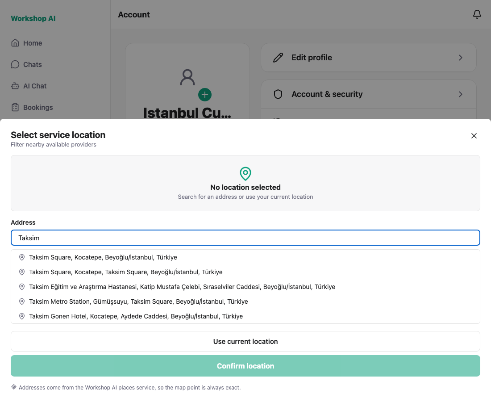
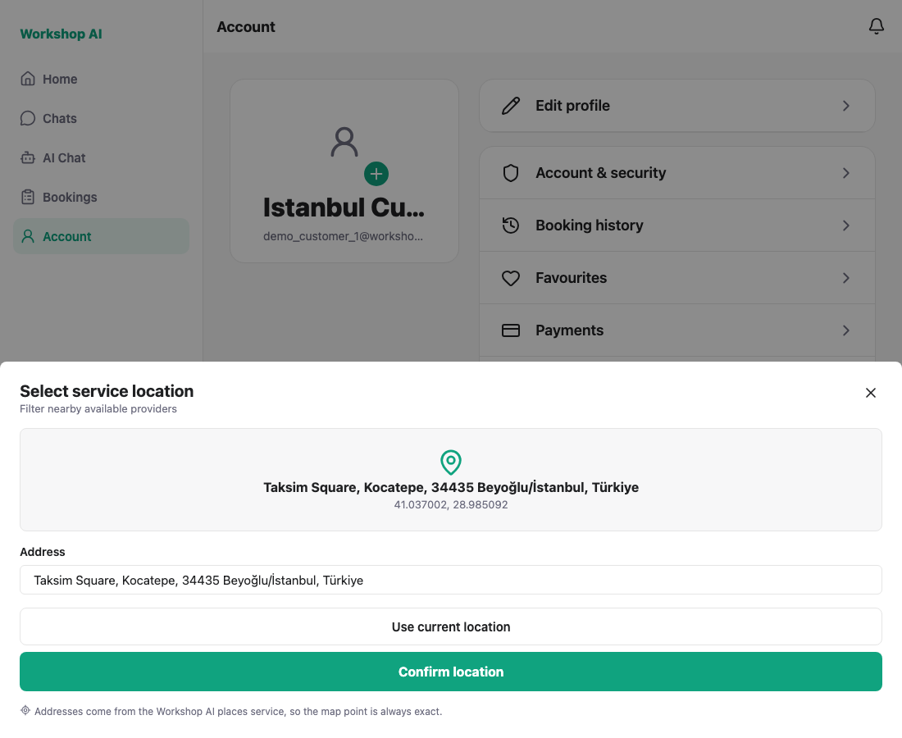
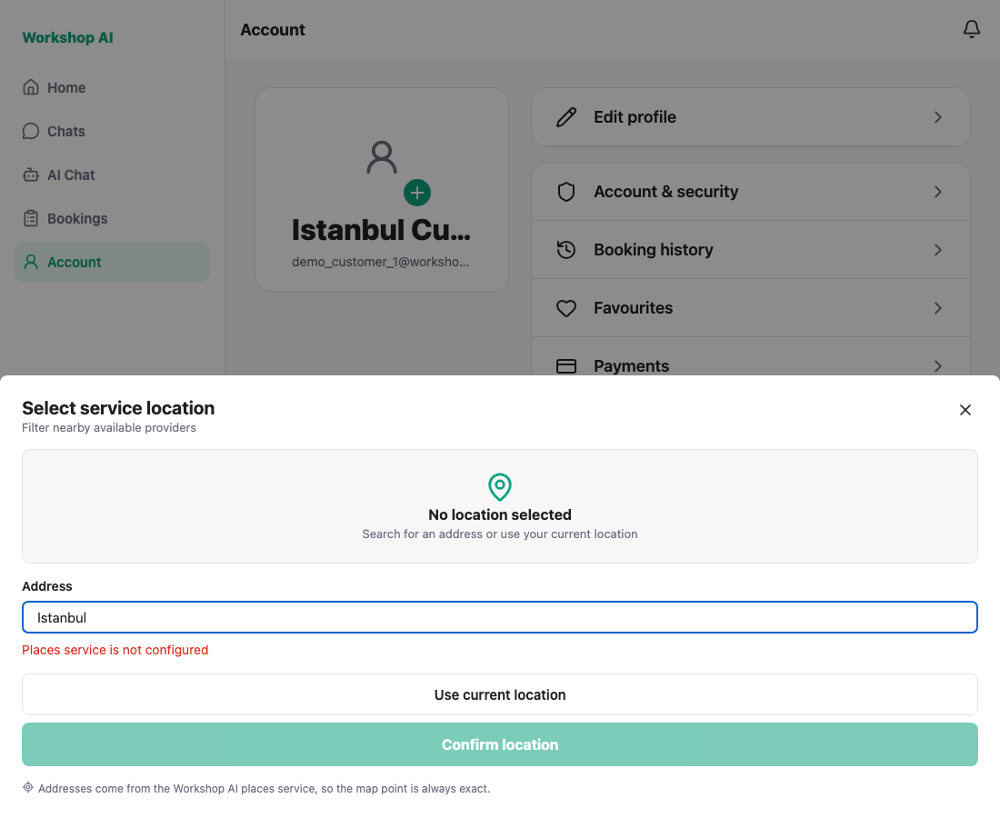

# Address autocomplete — historical captures

These screenshots and the capture log preserve an earlier local run. They are
historical UI evidence; no browser recapture or live Places check was performed
for this foundation.

Captured against the live backend with a **real Google Places API key**
configured in `WORKSHOP_GOOGLE_MAPS_API_KEY`. The suggestions and coordinates
below came from Google through our own proxy.

For these component captures, a temporary Account row opened the picker.
That capture-only entry is not part of the application; re-running this script
requires an equivalent local entry point.

## 1. Typing shows live suggestions

Five real results for "Taksim", debounced so a keystroke does not cost a request
to the rate-limited proxy.



## 2. Picking a suggestion fills the coordinates

`/places/details` returned `Taksim Square, Kocatepe, 34435 Beyoğlu/İstanbul,
Türkiye` at `41.037002, 28.985092` — the same values the API returns when
called directly. Confirm only becomes available once a place is chosen, and
there is no way to type a coordinate any more.



## 3. Without a key, the backend's error is shown

Captured before the key was configured, and still the state a fresh clone sees:
the proxy answers `503 Places service is not configured` and the picker shows
that message instead of an empty list.



---

## Current prerequisites and historical capture commands

Use a disposable database upgraded to the latest migration, the current API and
Expo Web on port 8090, and a verified customer account. Review the helper's
historical selectors and provide the capture-only picker entry described above.
The live mode needs a separately configured Google Places key and vendor access;
the unconfigured mode needs an API started without that key. Keep credentials in
ignored local configuration.

`shoot.js` drives the flow with Playwright and asserts the acceptance criteria.
It records every network request the picker makes and fails if any of them goes
to `maps.googleapis.com`, which is how "all three platforms only call our
/places APIs" is checked rather than assumed. Live results are matched by shape,
not by one exact string, because Google's wording changes.

```bash
node docs/testing/address-autocomplete/shoot.js                    # live, needs the key
MODE=unconfigured node docs/testing/address-autocomplete/shoot.js  # no key, error path
```

A clean live run prints:

```
PASS: picker opens with nothing selected
PASS: typing shows live suggestions from /places/autocomplete
PASS: picking "Taksim Square, Kocatepe, Beyoğlu/İstanbu…" filled coordinates from /places/details (41.037002, 28.985092)
PASS: the chosen place's formatted address is shown
PASS: only our proxy was called (2 request(s), no maps.googleapis.com)
PASS: the hand-typed latitude and longitude fields are gone
ALL CHECKS PASSED
```

The key lives only in `.env`, which is gitignored and excluded from the repository.
