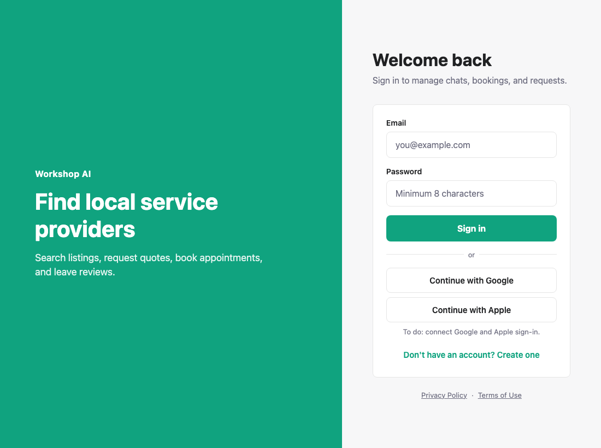
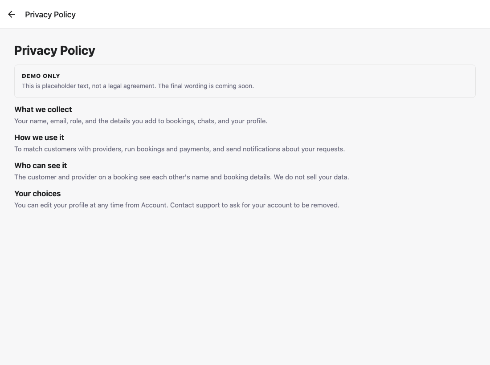
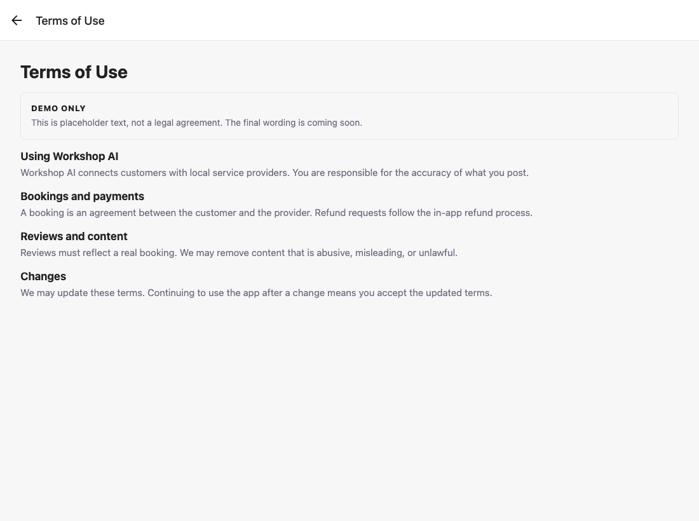
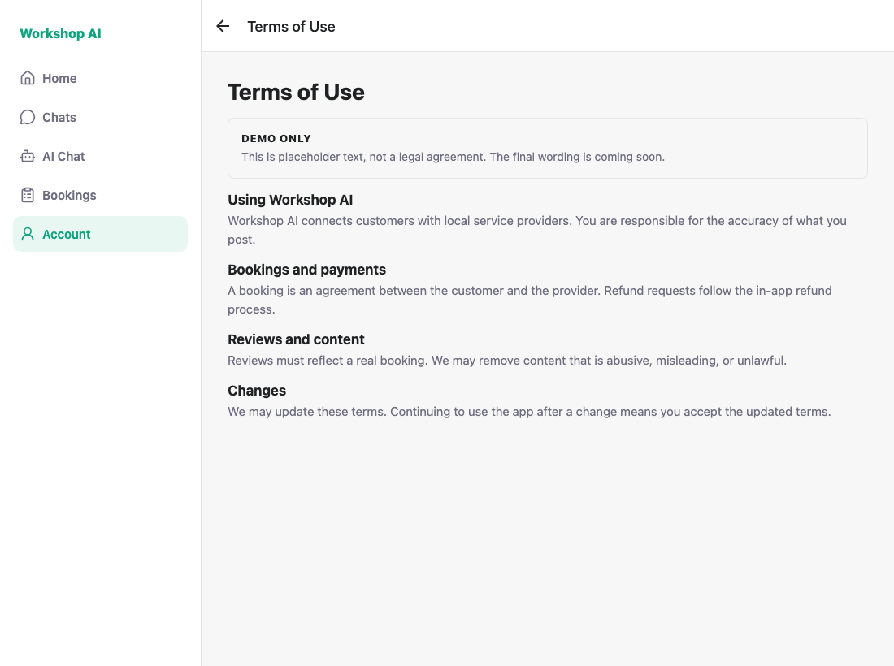
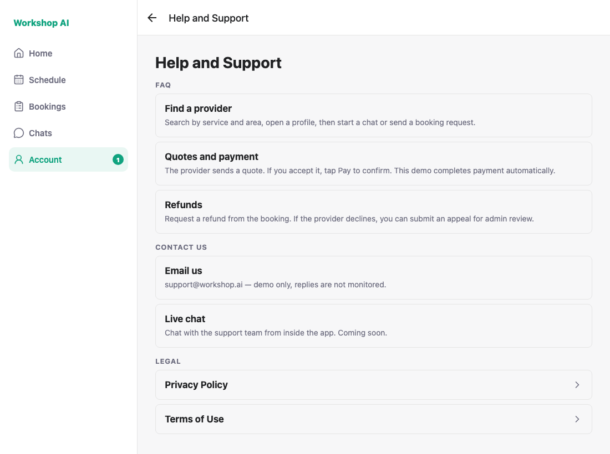
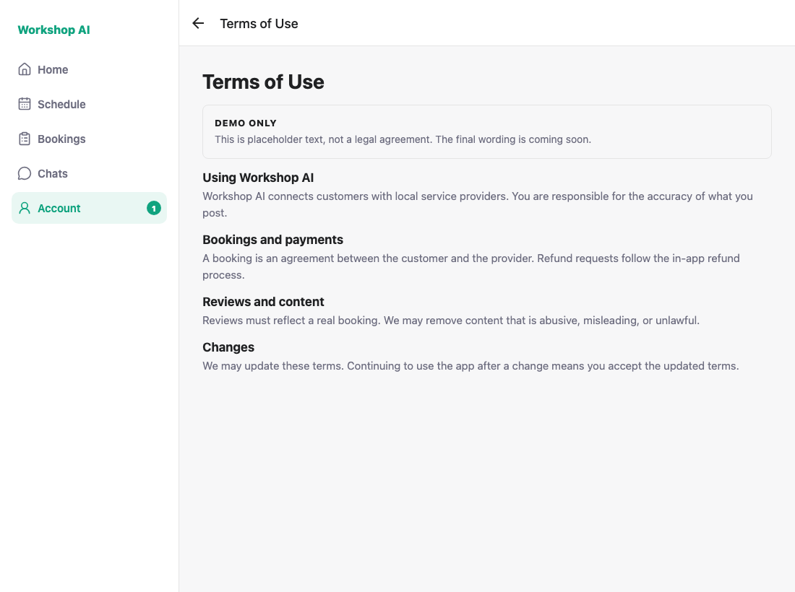

# Privacy and Terms pages — historical captures

These screenshots and the capture log preserve an earlier local run. They are
historical UI evidence; no browser recapture was performed for this foundation.

Captured against the locally running app, signed out and then signed in as
`demo_customer_1@workshop.ai` and `demo_provider_16@workshop.ai`. Every image is
a real run, not a mockup.

## 1. Sign-in screen links to both pages

Register happens signed out, so the pages have to open without a session. The
links sit under the form; the register checkbox links to the same routes.



## 2. Privacy Policy — signed out

Placeholder copy, marked **Demo only**.



## 3. Terms of Use — signed out



## 4. Terms of Use — customer

Reached from Account → Help and Support → Legal.



## 5. Help and Support — provider

The signed-in entry point: a **Legal** section with both pages.



## 6. Terms of Use — provider

The same page the customer and the signed-out visitor see.



---

## How these were captured

`shoot.js` drives the flows with Playwright and asserts the acceptance criteria
instead of leaving them to the eye. "Same page for both roles" is checked by
comparing the visible section headings across all three sessions. A clean run
prints:

```
PASS: sign-in screen links to both legal pages
PASS: Privacy opens signed out, marked Demo only
PASS: Privacy shows placeholder sections
PASS: Terms opens signed out, marked Demo only
PASS: signed out, customer and provider see the same Terms page
ALL CHECKS PASSED
```

For a new run, use a disposable database upgraded to the latest migration,
verified seeded customer/provider accounts, and the current API. Review the
helper's historical selectors and legal-page text before reusing it. Start
`npx expo start --web --port 8090` both up:

```bash
node docs/testing/legal-pages/shoot.js
```
