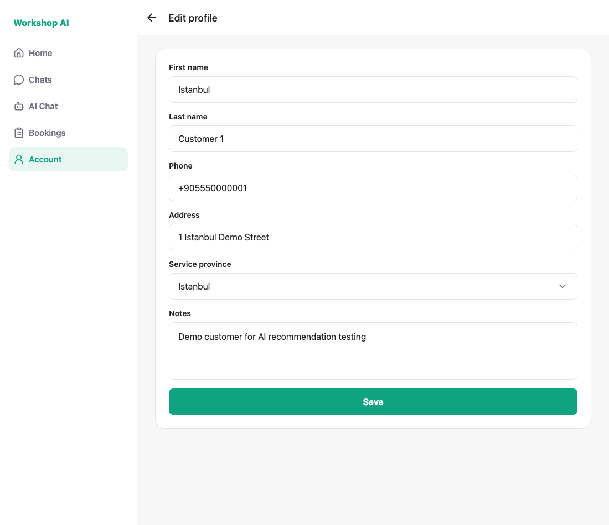
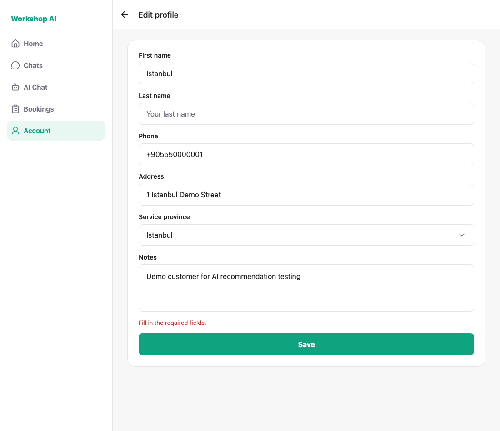
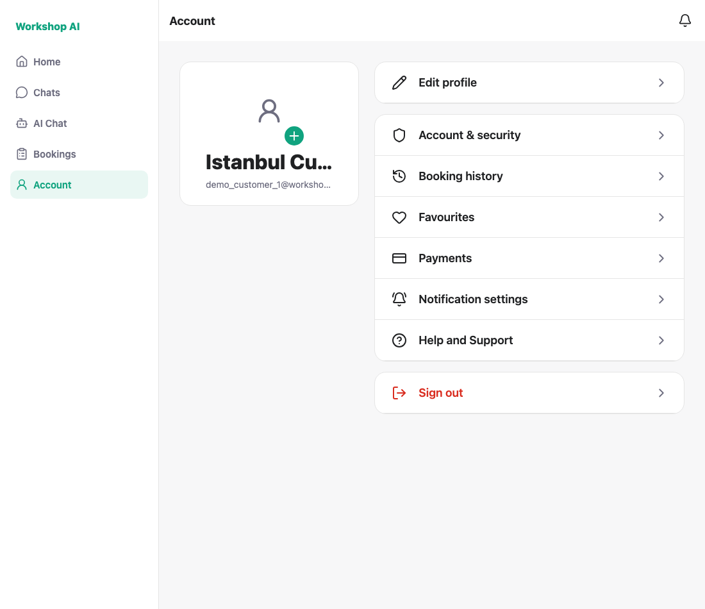

# Profile name editing — historical captures

These screenshots and `shoot.js` preserve earlier local runs. They are historical
UI evidence, not verification of the current foundation build. No new browser
capture was made during this review.

`users.name` stays the joined display string that chat and bookings read; the
edit screen splits it into two fields and joins it back.

## Both API shapes

The legacy API accepted a joined display name. The current split-name API **rejects a
payload carrying `name` together with
`first_name` / `last_name`** ("Use name or split name fields, not both"), so the
two input shapes cannot be mixed. These earlier runs compared two API versions:

| Mode | Backend | What the screen sends |
| --- | --- | --- |
| `fallback` | historical name-only API | `PATCH /me { name: "First Last" }` |
| `split` | split-name API, now supported by the current foundation | `PATCH /me { first_name, last_name }` |

The split run was confirmed at the database, not just in the UI:

```
name                | first_name | last_name
Istanbul Customer 1 | Istanbul   | Customer 1
```

Before that run both columns were `NULL`, so the split fields really were
written by the screen.

## 1. The joined name arrives split across two fields



## 2. An empty half is rejected before any request



## 3. Saving joins the two fields back into the display name

Account shows `Istanbul Customer One` after the edit; the screenshot below is
from the split run, after the account was restored.



---

## Current prerequisites and historical capture commands

Use a disposable seeded database upgraded to the latest migration, the current
API, an Expo Web client on port 8090, and Playwright with Chromium. The helper
expects `demo_customer_1@workshop.ai`, its seeded password, and the original name
`Istanbul Customer 1`. Sign-in must satisfy current email verification; use the
actual emailed code when required. Provider names cannot be changed while
identity review is pending or approved.

Review the helper's historical selectors before reuse. `MODE=split` selects the
current response shape; the default fallback label documents an old capture.

```bash
MODE=split node docs/testing/profile-name-editing/shoot.js
```

The helper changes and then attempts to restore the demo account's name.
The earlier successful run printed:

```
PASS: edit shows the name split: Istanbul / Customer 1
PASS: an empty last name blocks the save
PASS: saving joins the two fields back into the display name (Istanbul Customer One)
PASS: the demo account is restored
ALL CHECKS PASSED
```
