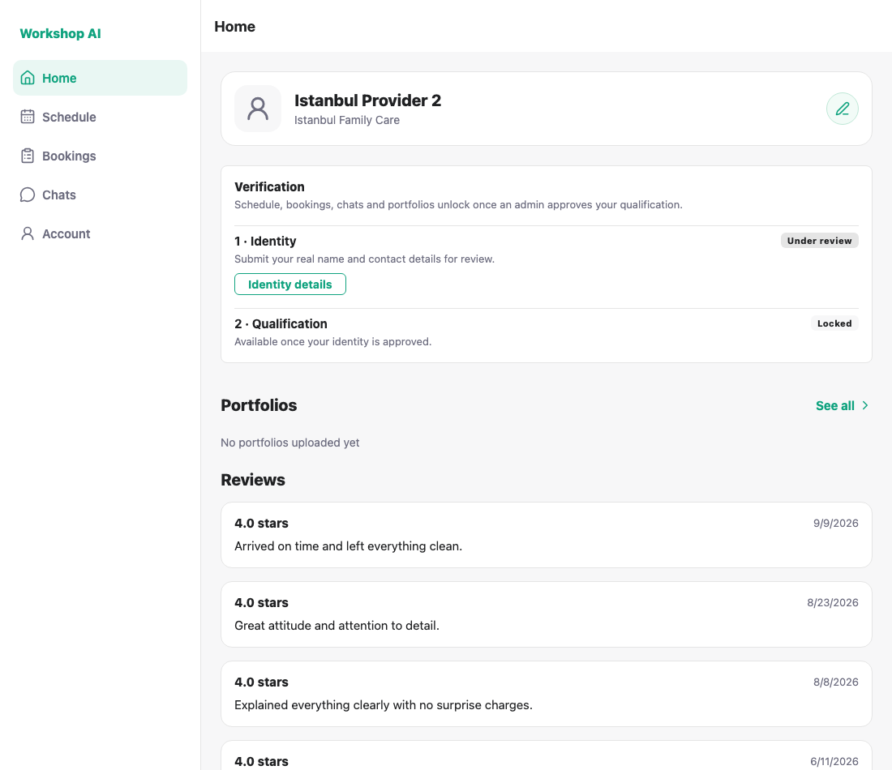
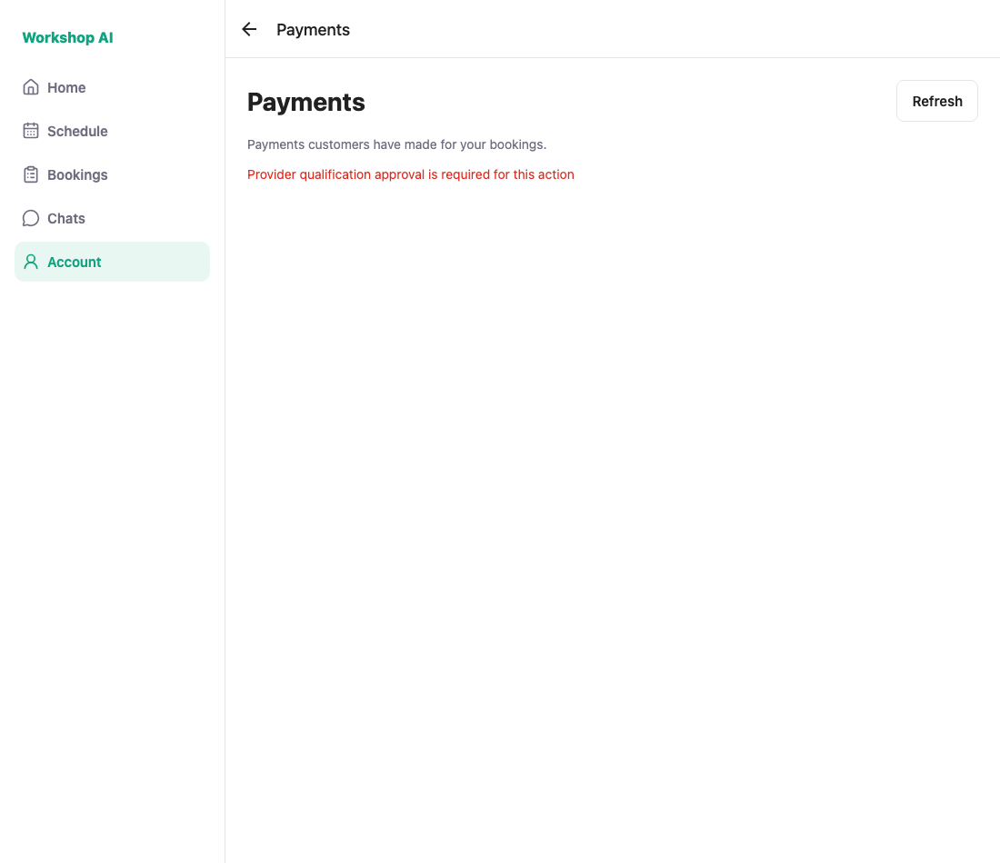
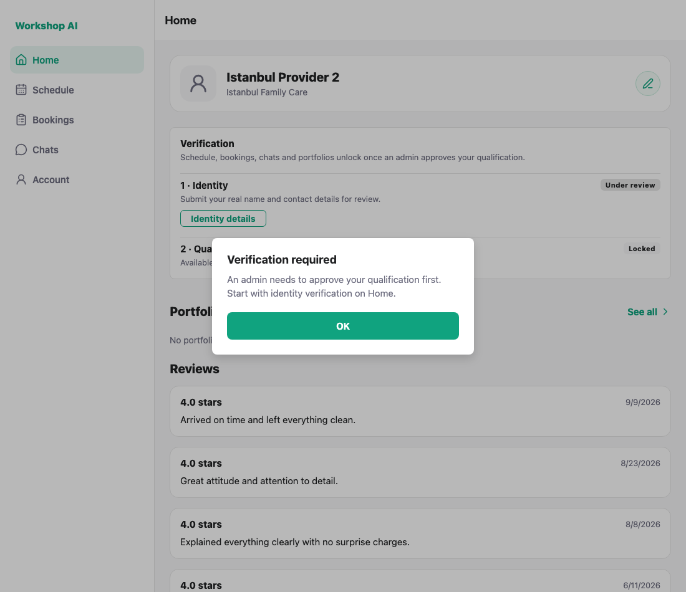
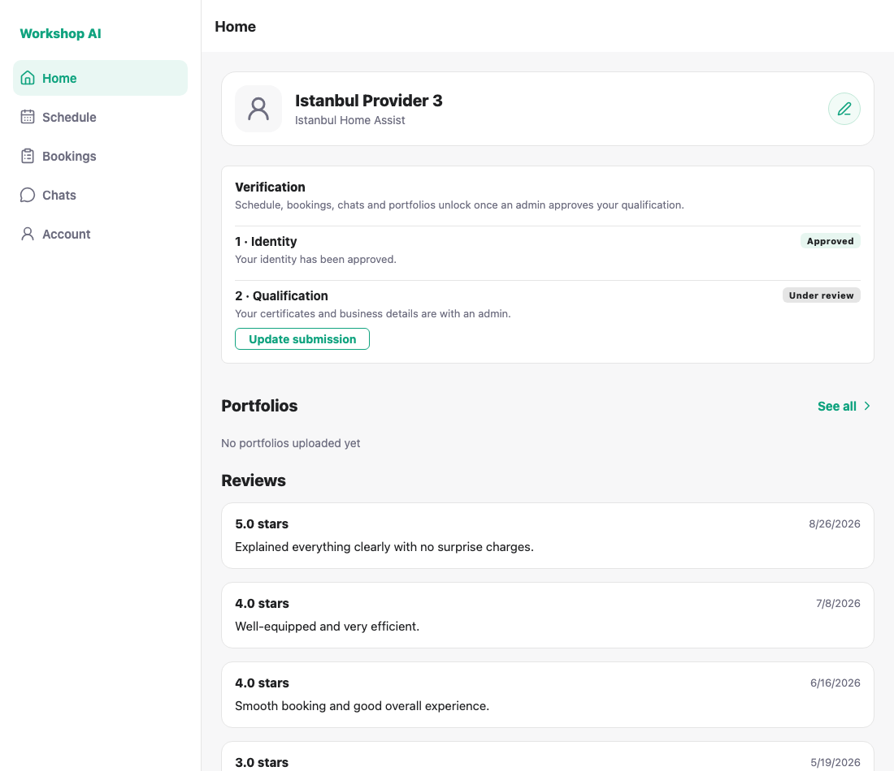
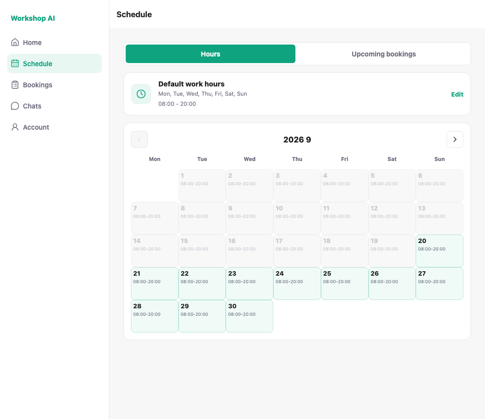

# Provider workspace access — historical captures

These screenshots and the capture log preserve an earlier local run with a
separate API worktree. They are historical UI evidence; no browser recapture was
performed for this foundation.

## What this ran against

These captures used an API from a separate local worktree with distinct identity
and qualification approval states. The mobile app was from the earlier checkout;
both connect to the same seeded database.

Three providers stand for the three states:

| Account | identity | qualification |
| --- | --- | --- |
| `demo_provider_2` | pending | pending |
| `demo_provider_3` | approved | pending |
| `demo_provider_16` | approved | approved |

`demo_provider_2` kept the legacy `verification_status = approved` on purpose,
so these screenshots also prove the gate reads the **new** fields rather than
the old one.

## 1. Identity under review — qualification is Locked

Step 2 reads **Locked**, not "Under review": nothing has been submitted to an
admin yet, and it offers no action. Reviews still render even though portfolios
answer 403, because the two lists are fetched independently.



## 1b. The lock covers working surfaces only

Account and Security, Help and Support and Payments all open while the
qualification is unapproved — a provider waiting for review can still change a
password or read help. Only schedule, bookings, chats and portfolios are gated.



The Payments screen opens; the **backend** then refuses the data for an
unapproved provider (`Provider qualification approval is required for this
action`) and the screen shows that message. Data access is enforced by the API
independently of the navigation gate.

## 2. A complete profile no longer opens the app

This provider's profile is fully filled in. Under the old gate that was enough
to unlock the tabs; now the tab explains what is actually needed.



## 3. Identity approved — the qualification is with an admin

The pill reads **Under review** and the action is **Update submission**: the
step has started, so offering to "apply" would be wrong.



## 4. Qualification approved — everything is unlocked

Tapping Schedule opens it instead of showing the dialog.



---

## Loading the profile independently of gated lists

The API used for these captures answers **403** for portfolios and reviews
until qualification is approved. Provider Home loaded the profile and those
two lists together and discarded everything when any of them failed, so an
unapproved provider saw an empty Home with no name, no status and no
verification entry point.
Loading the profile is now separate, and a 403 on the gated
lists is treated as expected rather than as an error.

## How these were captured

```bash
node docs/testing/provider-workspace-access/shoot.js
```

A clean run prints:

```
PASS: Provider Home shows the verification card
PASS: identity is the first step and is actionable
PASS: qualification waits for identity
PASS: the blocked qualification step reads Locked and offers no action
PASS: a complete profile no longer unlocks the tabs
PASS: Account and Security stays open while the qualification is unapproved
PASS: Help and Support stays open while the qualification is unapproved
PASS: Payments stays open while the qualification is unapproved
PASS: an approved identity is shown as approved
PASS: an in-review qualification offers Update submission, not Apply
PASS: an approved qualification says the account is live
PASS: an approved provider reaches the Schedule tab
ALL CHECKS PASSED
```

For a new run, use the current API and Expo Web on port 8090 with a disposable
database upgraded to the latest migration. Seed verified accounts and explicitly
set the three identity/qualification states above; default seeds do not prove
these distinct cases. Review the helper's historical selectors before reuse.
