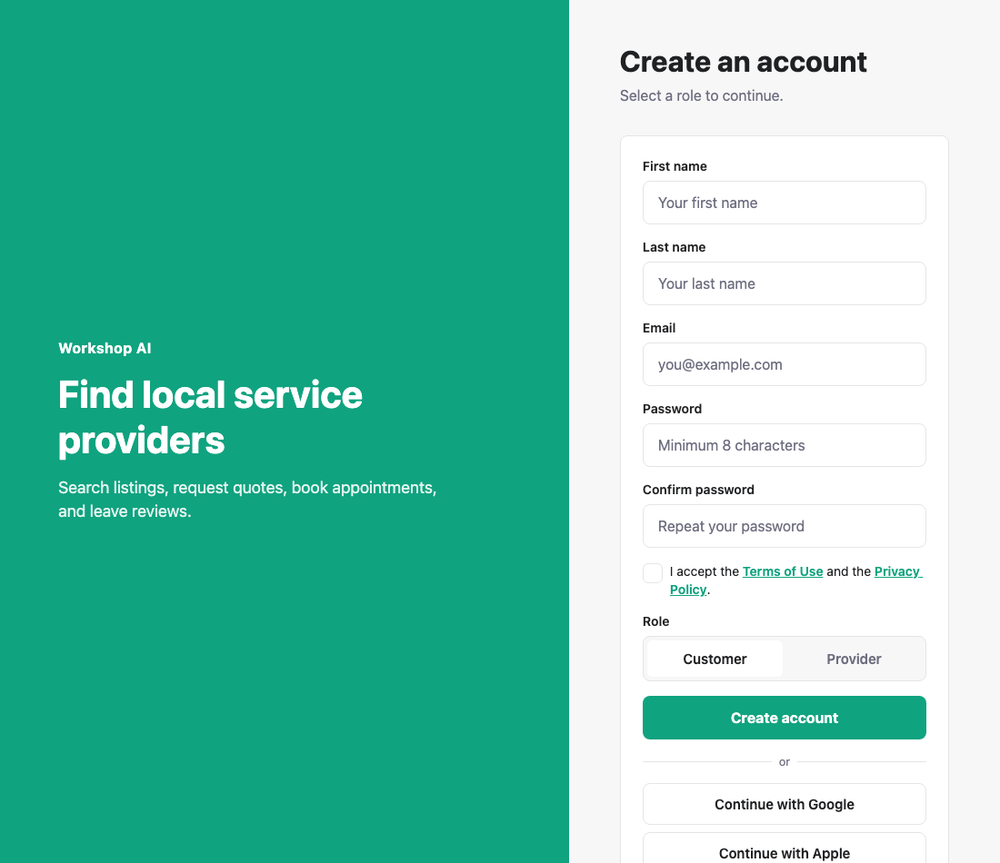
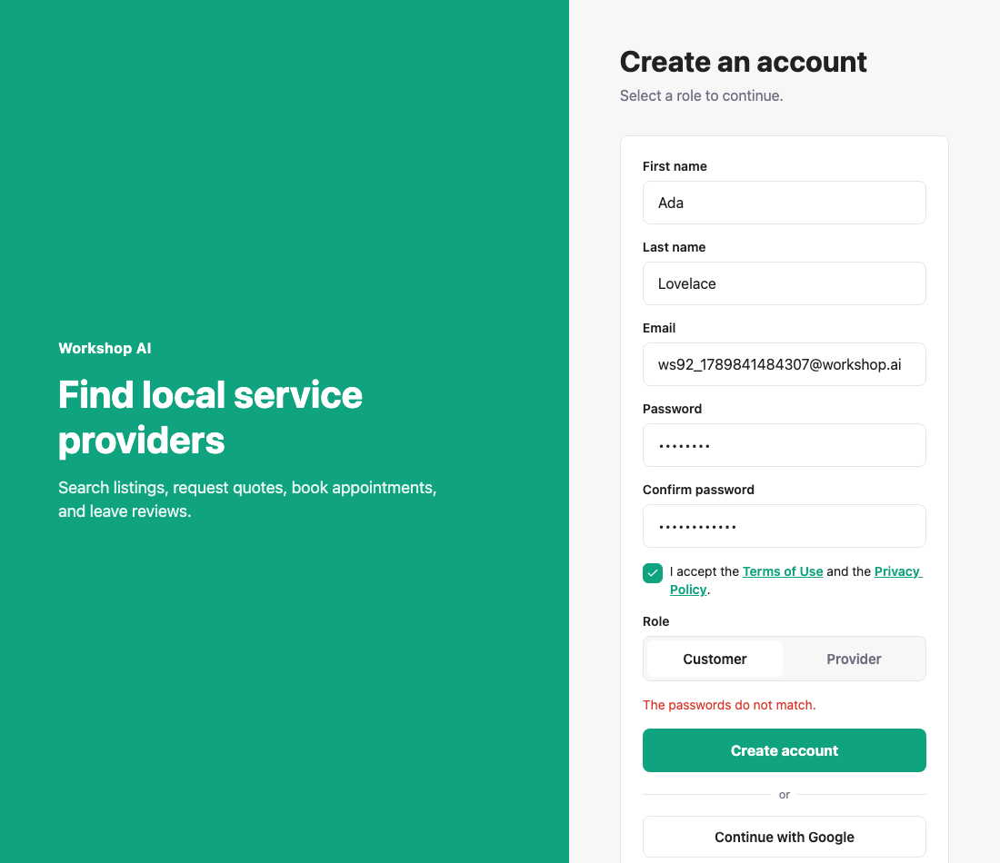
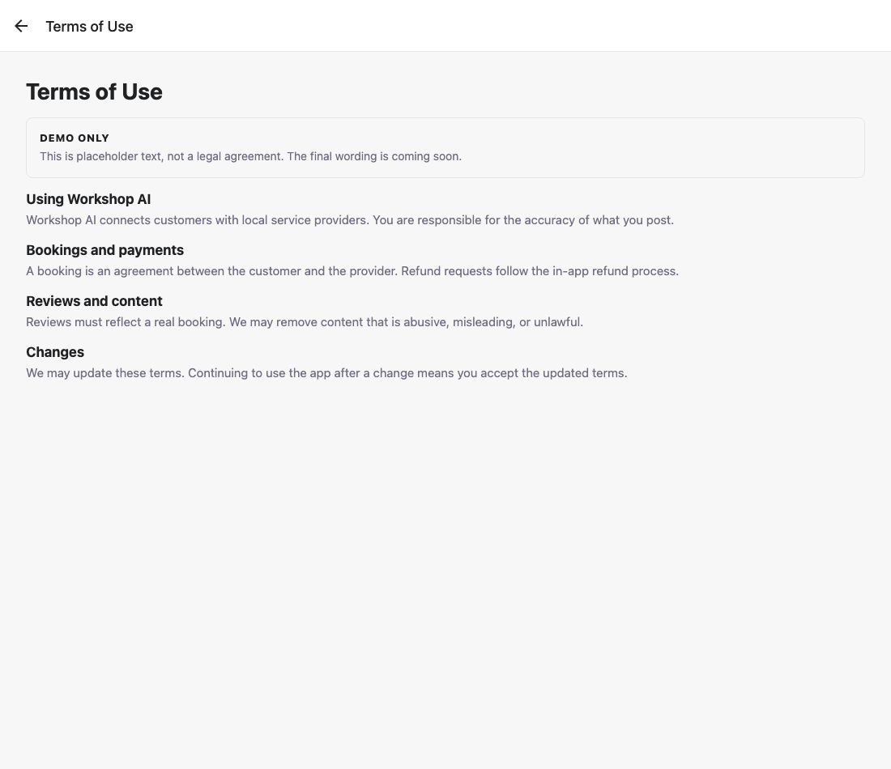
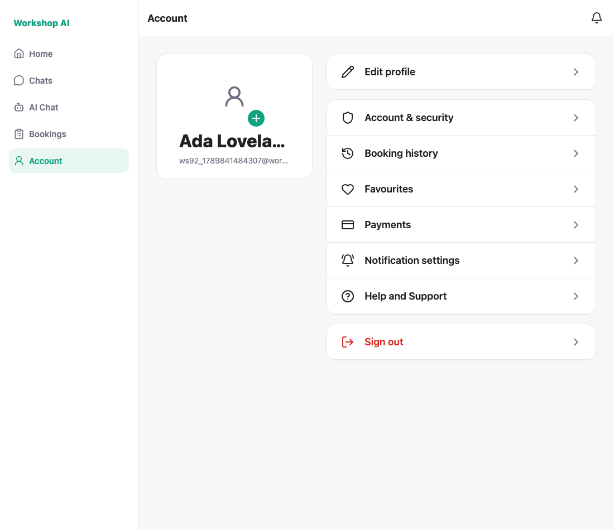

# Registration — historical captures

These screenshots and the capture log preserve an earlier local run. They are
historical UI evidence; no browser recapture was performed for this foundation.

Captured against a locally running API on a seeded database. Each run registers
a fresh address, so the script can be re-run without cleanup.

These captures cover registration. Editing an existing account is covered by
the separate profile-edit captures.

## 1. The register form

First name, last name, email, password, confirm password, a required Terms
checkbox that links to the legal pages, then the role.



## 2. Mismatched passwords block the submit

Caught in the screen, before any request.



## 3. An unticked Terms box blocks the submit


## 4. The Terms link opens the legal page

Tapping the link inside the checkbox row opens the real Terms page rather than
just ticking the box.



## 5. A complete form registers and signs in

The display name is the two names joined, which is what chat and bookings read.



---

## Name-field compatibility in the captured payload

The captured form sent both split fields and a joined display name:

```json
{
  "first_name": "Ada",
  "last_name": "Lovelace",
  "confirm_password": "…",
  "tos_accepted": true,
  "name": "Ada Lovelace",
  "email": "…", "password": "…", "role": "customer"
}
```

At capture time, that API required `name` and ignored the split
fields. The separate split-name API required both split fields and built the
display name on the server. Both accepted the payload above; screenshot 5 was
captured against that earlier API. This section documents the name fields,
not the complete current sign-up contract.

## Current prerequisites and historical capture command

Use a disposable database upgraded to the latest migration, the current API and
Expo Web on port 8090, and a fresh email address. Current registration requires
the email-code flow: configure a development email backend, obtain the actual
code it sends, and satisfy its recipient, expiry and attempt checks. The helper
predates that flow and must be updated before its signed-in assertion can verify
the current build; a fabricated code is not accepted.

Each case reloads the form first, so the tick state is always known: reading it
back from the DOM proved unreliable. A clean run prints:

```
PASS: register asks for first name and last name
PASS: register asks to confirm the password
PASS: mismatched passwords block the submit
PASS: an unticked Terms box blocks the submit
PASS: the Terms link opens the legal page
PASS: registered … and signed in
PASS: the joined display name is what chat and bookings will read
ALL CHECKS PASSED
```

```bash
node docs/testing/registration/shoot.js
```
