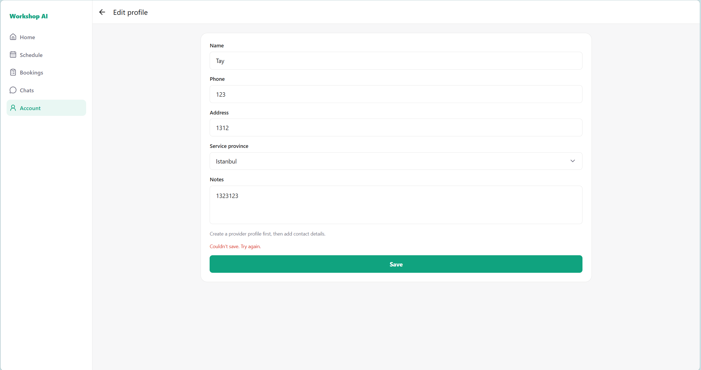

# Workshop AI Functional Requirements Improvements

## 1. Document Overview

This document summarizes the current functional gaps and improvement requirements for Workshop AI across the Customer, Provider, and Admin experiences. The original Chinese requirement IDs are preserved where possible. The duplicated `Re11` entry has been split into `REQ-11A` and `REQ-11B` for clearer tracking.

## 2. Priority and Status Legend

| Priority | Meaning |
| --- | --- |
| P0 | Critical requirement or blocking user experience issue. |
| P1 | Important improvement, but not immediately blocking the core flow. |

| Status | Meaning |
| --- | --- |
| To Do | Requirement is pending implementation or confirmation. |
| Partially Done | Some required behavior is implemented and connected, while other behavior in the same requirement remains outstanding. |
| Done | Requirement has been implemented, fixed, or temporarily closed based on the latest note. |
| Needs Confirmation | Requirement detail or expected behavior still needs confirmation. |

## 3. Requirement Summary

| ID | Status | Priority | User Role | Feature Area | Summary |
| --- | --- | --- | --- | --- | --- |
| REQ-01 | To Do | P1 | Customer, Provider | Login | Integrate Google and Apple quick login. |
| REQ-02 | Partially Done | P0 | Customer, Provider | Registration | Improve registration with confirm password, separated names, email verification, address validation, and required agreements. |
| REQ-03 | To Do | P0 | Customer | Home Search Results | Add filtering and sorting to provider search results. |
| REQ-04 | Partially Done | P0 | Customer | Home Search Results | Improve provider result cards with richer provider information, sorting, and filters. |
| REQ-05 | Partially Done | P1 | Customer | Service Area | Refine service area granularity from province level to province, city, and district/suburb level. |
| REQ-06 | Done | P0 | Customer | Provider Profile | Show business operating status and support favorite providers. |
| REQ-07 | Partially Done | P0 | Customer, Provider | Booking / Request Form | Add request title, attachments, clearer preferred time window semantics, and improved service address selection. |
| REQ-08 | Partially Done | P0 | Customer | Account / Edit Profile | Improve customer profile fields, phone verification, default suburb, and service address management. |
| REQ-09 | Done | P0 | Customer | Session / Authentication | Investigate frequent refresh/session expiry issue. Temporarily not reproduced as of 2026-09-09. |
| REQ-10 | Done | P0 | Customer, Provider | Account & Security | Add change password, change email, and correct page title. |
| REQ-11A | Partially Done | P0 | Customer, Provider | Account / Notifications | Separate notifications from notification settings. |
| REQ-11B | Partially Done | P1 | Customer, Provider | Account | Add Payments, Legal, Help and Support, FAQ, Contact Us, and Language settings. |
| REQ-12 | Done | P0 | Customer | Account | Add a Favorite Providers page. |
| REQ-13 | Partially Done | P0 | Provider | Provider Home / Verification | Redesign provider real-name verification, qualification verification, and business operation settings. |
| REQ-14 | Done | P0 | Customer, Provider | Edit Profile | Fix profile update behavior and clarify restrictions before provider verification. |
| REQ-15 | To Do | P1 | Customer, Provider | Account / Payments | Add payment-method management, payment details, provider payment filters, and a payout-account entry while preserving the existing payment-history functionality. |

## 4. Detailed Requirements

### REQ-01: Quick Login Integration

| Field | Details |
| --- | --- |
| Original ID | Re01 |
| Priority | P1 |
| User Role | Customer, Provider |
| Feature Area | Login |
| Status | To Do |

**Requirements**

- Integrate Google quick login.
- Integrate Apple quick login.

**Reference Screenshot**


---

### REQ-02: Registration Flow Improvements

| Field | Details |
| --- | --- |
| Original ID | Re02 |
| Priority | P0 |
| User Role | Customer, Provider |
| Feature Area | Registration |
| Status | Partially Done |

**Requirements**

- Add a confirm password step.
- Split the current `Name` field into `Last Name` and `First Name`.
- Convert user-entered name values to uppercase before saving them to the database.
- Add email verification during registration.
- Add a required address information step.
- Address information must be collected at least down to suburb level.
- Integrate a map/address API so users can type partial address information and select from recommended address results.
- Users must only be allowed to select an address returned by the recommendation API.
- Add required checkboxes for agreements such as Terms of Service and Privacy Policy.

**Implementation Review — 2026-09-22**

- Done in the connected frontend:
  - Confirm password validation
  - Separate First Name and Last Name fields
  - Required Terms of Use and Privacy Policy acceptance
  - Links to the Terms of Use and Privacy Policy pages
- Remaining:
  - Email verification as part of the registration journey
  - Required address collection during registration
  - Recommended-address-only selection and validation
- Needs confirmation:
  - This document requests uppercase name storage, while the current frontend references FDS rule `C-R05` and intentionally preserves the user's entered casing.

**Reference Screenshot**


---

### REQ-03: Search Result Filtering and Sorting

| Field | Details |
| --- | --- |
| Original ID | Re03 |
| Priority | P0 |
| User Role | Customer |
| Feature Area | Home Search Results |
| Status | To Do |

**Requirements**

- Add filters to the home search results page.
- Filtering must support:
  - Category
  - Distance
  - Price
  - Rating
  - Availability, mapped to open/closed status
- Add sorting to the home search results page.
- Sorting must support:
  - Nearest distance
  - Lowest price
  - Highest rating

**Reference Screenshot**


---

### REQ-04: Provider Result Card Improvements

| Field | Details |
| --- | --- |
| Original ID | Re04 |
| Priority | P0 |
| User Role | Customer |
| Feature Area | Home Search Results |
| Status | Partially Done |

**Requirements**

- Each provider result card must display:
  - Provider cover/home image
  - Provider avatar
  - Provider name
  - Distance from the customer's current location to the provider address
  - Business operating status, shown as open or closed
  - Provider category
  - Provider online status
- Add sorting options:
  - Nearest distance
  - Lowest price
  - Highest rating
- Add filters:
  - Distance
  - Price
  - Category

**Implementation Review — 2026-09-22**

- Done in the connected frontend:
  - Provider portfolio/cover image
  - Provider business name
  - Provider category tags
  - Provider online/offline status
- Remaining:
  - Provider avatar on the result card
  - Distance
  - Open/closed business status on the result card
  - Price and rating presentation
  - Customer-facing sorting and filtering controls

**Reference Screenshot**


---

### REQ-05: Customer Service Area Granularity

| Field | Details |
| --- | --- |
| Original ID | Re05 |
| Priority | P1 |
| User Role | Customer |
| Feature Area | User Service Area |
| Status | Partially Done |

**Requirements**

- The current service area is only stored or selected at province/state level.
- Refine the service area structure to support province/state, city, and district/suburb level.

**Implementation Review — 2026-09-22**

- The backend supports hierarchical service-location data.
- The connected Customer frontend still selects and saves only a province, so the city and district/suburb journey remains outstanding.

**Reference Screenshot**


---

### REQ-06: Provider Profile Enhancements

| Field | Details |
| --- | --- |
| Original ID | Re06 |
| Priority | P0 |
| User Role | Customer |
| Feature Area | Provider Profile |
| Status | Done |

**Requirements**

- Display provider business operating status, shown as open or closed.
- Add a Favorite Provider feature so customers can save providers.

**Implementation Review — 2026-09-22**

- Provider detail displays open/closed operating status.
- Customers can add and remove providers from favorites, and the state is synchronized with the Favorite Providers page.

**Reference Screenshot**


---

### REQ-07: Booking / Request Form Improvements

| Field | Details |
| --- | --- |
| Original ID | Re07 |
| Priority | P0 |
| User Role | Customer, Provider |
| Feature Area | Booking / Request Form |
| Status | Partially Done |

**Requirements**

- Add a required `title` field to the request booking form.
- `title` must briefly summarize the customer's request.
- `title` must be limited to 30 words.
- Add an optional `attachments` field.
- `attachments` must support:
  - Up to 5 images, each under 2 MB
  - Up to 2 videos, each under 10 MB
- Update the meaning of the current `start_time` and `end_time` fields.
- These fields should represent a `preferred_time_window`, meaning the customer's preferred time range for the provider to visit or complete the service.
- Avoid presenting `start_time` and `end_time` as a confirmed booking time unless the provider has accepted or confirmed it.
- Improve service address selection with the following options:
  - User types an address and selects one of the map API recommended addresses.
  - User selects a saved service address from their profile.
  - User uses their current location directly.

**Implementation Review — 2026-09-22**

- Booking creation, booking times, service-address fields, and backend attachment/title contracts exist.
- The connected booking-request frontend does not yet expose the required title, request attachments, saved addresses, current-location selection, or map-recommended address selection.
- The current frontend still presents start and end values as scheduled times rather than explicitly as a preferred time window.

**Reference Screenshot**


---

### REQ-08: Customer Profile and Service Address Improvements

| Field | Details |
| --- | --- |
| Original ID | Re08 |
| Priority | P0 |
| User Role | Customer |
| Feature Area | Customer / Account / Edit Profile |
| Status | Partially Done |

**Requirements**

- Split the current `Name` field into `Last Name` and `First Name`.
- Convert user-entered name values to uppercase before saving them to the database.
- Phone number binding or updates must require verification.
- Rename or replace `Service Province` with `Default Suburb`.
- Move `Service Address` out of the edit profile page and place it under the Account area.
- Service address management must support:
  - Editing up to 5 service addresses.
  - Displaying the default address by default.
  - Adding a service address by typing an address and selecting a map API recommended address.

**Implementation Review — 2026-09-22**

- Done in the connected frontend:
  - Separate First Name and Last Name fields
  - Independent profile-field updates
  - Phone number, address, and service-province editing
- Remaining:
  - Verified phone-number update journey
  - Default Suburb replacement for Service Province
  - Dedicated saved Service Address management
  - Up to five saved service addresses
  - Map-recommended address selection

**Reference Screenshots**


---

### REQ-09: Session Expiry / Frequent Refresh Issue

| Field | Details |
| --- | --- |
| Original ID | Re09 |
| Priority | P0 |
| User Role | Customer |
| Feature Area | Customer Session / Authentication |
| Status | Done / Temporarily Closed |

**Issue**

- The customer session appears to require a refresh after a short period of time, almost within 10 minutes.
- This may indicate an incorrect session expiry or token refresh configuration.

**Latest Note**

- As of 2026-09-09, this issue has temporarily not reappeared.

**Reference Screenshots**


---

### REQ-10: Account and Security Page Improvements

| Field | Details |
| --- | --- |
| Original ID | Re10 |
| Priority | P0 |
| User Role | Customer, Provider |
| Feature Area | Customer / Account / Account & Security |
| Status | Done |

**Requirements**

- Add Change Password.
- Add Change Email.
- Update the page title to `Account & Security`.

**Implementation Review — 2026-09-22**

- Change Password and Change Email are connected to backend actions.
- Email and phone verification controls are available on the Account and Security page.
- The page is exposed from the Account area for both Customer and Provider users.

**Reference Screenshot**


---

### REQ-11A: Notifications and Notification Settings Separation

| Field | Details |
| --- | --- |
| Original ID | Re11 |
| Priority | P0 |
| User Role | Customer, Provider |
| Feature Area | Account / Notifications |
| Status | Partially Done |

**Requirements**

- The current `Account / Notifications` module is used to display notifications.
- Notification display should be moved into a separate notification page or entry point, rather than being buried under Account in a way that hurts the user experience.
- The original `Account / Notifications` module should be repurposed as `Notification Settings`.
- `Notification Settings` should allow users to control push notification preferences.

**Implementation Review — 2026-09-22**

- Done in the connected frontend:
  - Notification inbox is a separate page and can be opened from the notification icon.
  - Account contains a separate Notification Settings entry.
- Remaining:
  - Notification Settings controls are still a placeholder and do not yet save push or email preferences.

**Reference Screenshot**


---

### REQ-11B: Additional Account Entries

| Field | Details |
| --- | --- |
| Original ID | Re11 |
| Priority | P1 |
| User Role | Customer, Provider |
| Feature Area | Account |
| Status | Partially Done |

**Requirements**

- Add a `Payments` entry under Account for both Customer and Provider users.
- Detailed role-specific payment requirements are defined in `REQ-15`.
- Add a `Legal` entry for Privacy Policy and Terms of Service.
- Rename `Help` to `Help and Support`.
- Add `FAQ` under Help and Support.
- Add `Contact Us` under Help and Support.
- Add a `Language` setting so users can change the application language.

**Implementation Review — 2026-09-22**

- Done in the connected frontend:
  - Payments entry and role-specific payment history
  - Privacy Policy and Terms of Use pages
  - Help renamed to Help and Support
  - FAQ content
  - Contact Us content
- Remaining:
  - Direct Account-level Legal entry; Legal pages are currently linked through Help and Support and authentication flows
  - Language setting
  - Payment methods and payment details, tracked under `REQ-15`

**Reference Screenshots**


---

### REQ-12: Favorite Providers Page

| Field | Details |
| --- | --- |
| Original ID | Re12 |
| Priority | P0 |
| User Role | Customer |
| Feature Area | Customer / Account |
| Status | Done |

**Requirements**

- Add a `Favorite Providers` page or account entry.
- Display providers that the customer has saved or favorited.

**Implementation Review — 2026-09-22**

- Customer Account contains a Favorites entry.
- The page lists saved providers, opens provider details, and supports removing a provider from favorites.

**Reference Screenshot**


---

### REQ-13: Provider Verification and Operation Settings Redesign

| Field | Details |
| --- | --- |
| Original ID | Re13 |
| Priority | P0 |
| User Role | Provider |
| Feature Area | Provider / Home / Business Verification |
| Status | Partially Done |

**Requirements**

- Redesign the original provider verification form.
- Add Real-Name Verification to the provider account page.
- Display verification statuses clearly, including:
  - Real-name verified / not real-name verified
  - Qualification verified / not qualification verified
- Providers must complete real-name verification before they can apply for qualification/business verification.
- The business verification form should follow the reference designs.
- Business verification must support two verification types:
  - Individual
  - Organization
- A provider account can only be verified as either an individual or an organization.
- Extract some existing provider verification settings into a separate `Business Operation Settings` area.
- Business Operation Settings should include fields such as:
  - Price
  - Service area

**Updated Provider Flow**

1. Provider registers an account.
2. Before identity submission, Provider can edit account name and account security fields.
3. Provider completes real-name verification.
4. Provider can then apply for qualification/business verification.
5. Full provider functionality and Business Operation Settings are unlocked after qualification approval.

**Implementation Review — 2026-09-24**

- Done in the backend:
  - Provider registration has no address and starts at identity `not_submitted` and qualification `locked`.
  - Identity applications snapshot first name, last name, date of birth, document type (`national_id` or `passport`), and one to five private PDF/PNG/JPG files (5 MB each).
  - Qualification applications are available only after identity approval, are immutable while pending, and support `personal` and `organisation` providers.
  - Organization applications require `legal_name` and a globally unique `unique_enterprise_id`; personal display names come from the approved account name.
  - Qualification applications contain description, contact phone, one exact business address with map coordinates/place ID, service categories, and one to five private qualification files.
  - Identity and qualification have separate Admin queues and decisions. Only pending applications can be reviewed and rejection requires a reason.
  - Qualification approval creates the current `ProviderProfile` and approved-service list. Application rows remain immutable audit snapshots.
  - Business Operation Settings are unlocked only after qualification approval and contain description, contact phone, current business address, hourly rate, enabled approved services, hierarchical service areas, and the existing weekly/date-specific availability settings.
  - `service_radius_km` and `experience_years` were removed. Distance uses business coordinates; service coverage uses province/city/district service-area records.
  - Existing approved providers are grandfathered as identity/qualification approved. Other legacy providers restart at identity `not_submitted` with qualification `locked` without deleting profiles or transaction history.
- Remaining frontend work:
  - Connect the Provider forms and Admin queues to the new endpoints.
  - Present organization `unique_enterprise_id` with the market-specific label (for Turkey, MERSIS/company identifier).

**Original Project Screenshots**


**Reference Screenshots**


---

### REQ-14: Edit Profile Update Behavior

| Field | Details |
| --- | --- |
| Original ID | Re14 |
| Priority | P0 |
| User Role | Customer, Provider |
| Feature Area | Edit Profile |
| Status | Done |

**Issues**

- Users cannot update a single profile field independently.
- Bug: the page shows an error message saying the profile cannot be updated and asks the user to try again.
- After refreshing, the profile still appears unsaved, but after logging out and logging back in, the change has actually been saved.

**Latest Notes**

- Profile update behavior was modified on 2026-09-10.
- Remaining requirement: define or implement the rule that unverified providers cannot perform any operation before completing required information verification.
- As of 2026-09-22, profile fields can be updated independently and provider schedule, bookings, chats, and portfolios are gated until qualification approval.

**Reference Screenshots**




---

### REQ-15: Customer and Provider Payments Experience

| Field | Details |
| --- | --- |
| Original ID | New |
| Priority | P1 |
| User Role | Customer, Provider |
| Feature Area | Account / Payments |
| Status | To Do |

**Existing Functionality — Done**

- A shared `Payments` entry exists under Account for Customer and Provider users.
- Customers can view payment records associated with their bookings.
- Providers can view customer payment records associated with their bookings.
- The shared Payments page displays role-specific content.

**Shared Navigation Requirements**

- Keep `Payments` as an Account-level entry for both Customer and Provider users.
- Display role-specific content from the existing shared Payments route.
- Do not introduce Payments as an additional primary navigation tab.

**Customer Information Architecture**

```text
Customer
└── Account
    └── Payments
        ├── Payment Methods
        │   └── Add / Edit Payment Method
        └── Payment History
            └── Payment Detail
```

- Checkout remains part of the booking journey:

```text
Customer
└── Bookings
    └── Booking Detail
        └── Checkout
            └── Select Payment Method
```

**Customer Payment Requirements — To Do**

- Allow customers to view available payment methods.
- Allow customers to add, remove, and select a default payment method.
- Allow customers to switch payment methods during checkout.
- Display only masked payment-method information.
- Do not display or store full card numbers or card security codes in the application UI.
- Add payment-history filters:
  - All
  - Pending
  - Paid
  - Refunded
  - Failed
- Add a Payment Detail page containing:
  - Payment ID
  - Booking ID and link to Booking Detail
  - Provider
  - Service or booking summary
  - Amount and currency
  - Masked payment method
  - Payment status
  - Created, paid, and refunded dates when applicable
- Checkout must display the booking summary, quoted amount, currency, selected payment method, and final payment amount before confirmation.
- Payment processing, success, and failure states must be visually distinguishable.

**Provider Information Architecture**

```text
Provider
└── Account
    └── Payments
        ├── Customer Payments
        │   └── Transaction Detail
        └── Payout Account
```

**Provider Payment Requirements — To Do**

- Present the Provider payment list as `Customer Payments`.
- Allow Provider users to filter customer payments by:
  - All
  - Pending
  - Paid
  - Refunded
  - Failed
- Each customer-payment item should display:
  - Payment amount and currency
  - Booking or service summary
  - Customer name
  - Payment status
  - Created, paid, and refunded dates when applicable
- Add a Transaction Detail page containing the same payment facts and a link to the associated Booking Detail page.
- Add a `Payout Account` entry under Provider Payments.
- Payout Account may collect or display the provider's future payout-destination information, subject to the selected payment provider and security design.

**Commercial Scope Boundary**

- Do not display or define:
  - Platform fees
  - Commission rates
  - Provider net earnings
  - Available or withdrawable balances
  - Withdrawal fees
  - Settlement or payout schedules
- These items require a separate confirmed commercial and settlement model.

**Reference Prototype**

- Customer and Provider Payments prototype to be maintained as an editable Draw.io artifact under `docs/ui/`.

## 5. Cross-Feature Dependencies and Open Items

| Area | Dependency / Open Item |
| --- | --- |
| Authentication | Google login, Apple login, email verification, password change, email change, and session refresh behavior should share a consistent authentication design. |
| Address Management | Registration, booking requests, customer profile, saved service addresses, and provider service area should use one consistent address model and map API integration. |
| Provider Discovery | Search result cards, filtering, sorting, provider availability, business status, category, price, rating, and distance should be designed as one provider discovery model. |
| Favorites | Favorite Provider actions on provider profiles should sync with the Favorite Providers page under Customer Account. |
| Notifications | Notification display and notification settings should be separated into different user journeys. |
| Provider Verification | Real-name verification, qualification/business verification, and business operation settings should be separated but connected by clear unlock rules. |
| Media Uploads | Booking/request attachments require clear limits, upload validation, storage rules, preview behavior, and error messages. |
| Name Handling | Registration currently preserves entered name casing according to FDS rule `C-R05`, while `REQ-02` requests uppercase database storage. The authoritative rule must be confirmed before changing name normalization. |
| Payments | Customer checkout, payment methods, payment history, provider customer-payment filters, refunds, and booking status must share one payment record and status model. Payout Account integration depends on the selected payment provider and security design. |

## 6. Recommended Implementation Order

| Order | Requirement IDs | Reason |
| --- | --- | --- |
| 1 | REQ-02, REQ-10 | Registration and account security affect both Customer and Provider access flows. |
| 2 | REQ-07, REQ-08 | Booking requests and service addresses depend on a consistent address model. |
| 3 | REQ-03, REQ-04, REQ-06, REQ-12 | Provider discovery and favorites should be implemented as one connected customer experience. |
| 4 | REQ-13, REQ-14 | Provider verification controls provider access and operation permissions. |
| 5 | REQ-11A, REQ-11B, REQ-05, REQ-01 | These improve account structure, localization, service-area precision, and login convenience. |
| 6 | REQ-15 | Extend the existing Payments entry after booking, refund, authentication, and Account navigation behavior are stable. |
